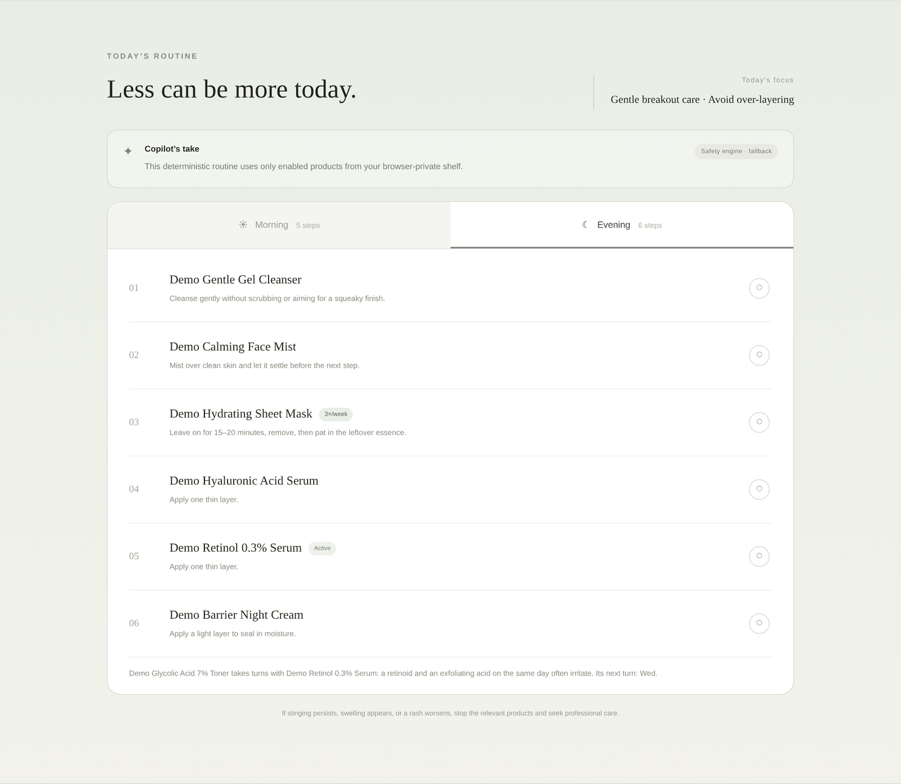
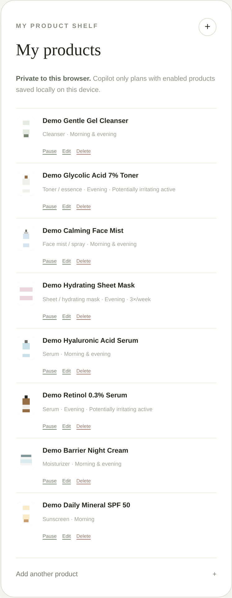
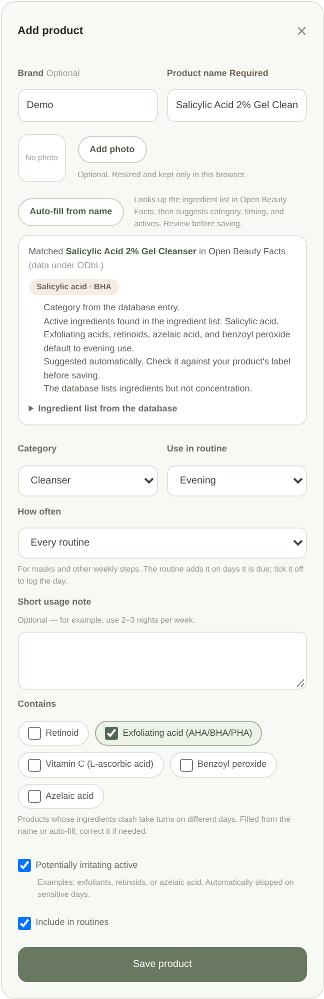
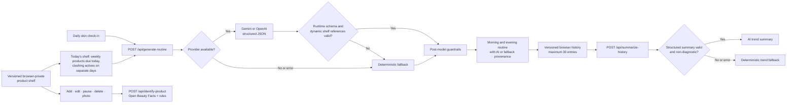

# Skin Routine Copilot

[](https://github.com/yanyan-milktea/skin-routine-copilot/actions/workflows/ci.yml)

A safety-first applied-AI skincare planner that turns a short daily check-in
into a practical morning and evening routine using only products the user
already owns.

**[Live demo → skin-routine-copilot.vercel.app](https://skin-routine-copilot.vercel.app)** (public, no sign-in)

<p align="center">
  
</p>
<p align="center">
  
  &nbsp;
  
</p>
<p align="center"><sub>Screenshots use synthetic demo products and drawn placeholder photos.</sub></p>

## What it does

- **Daily check-in → routine.** Breakouts, oiliness, redness, sensitivity, sleep and a short note become a morning and evening routine built only from the user's own products.
- **AI with deterministic guardrails.** Gemini writes the plan as strict JSON; code enforces the product allow-list, application order (cleanser → toner → mist → mask → serum → treatment → moisturizer → sunscreen), sunscreen last, time-of-day windows, and pauses actives on sensitive days. A deterministic planner takes over if the model is unavailable or wrong.
- **Ingredient conflicts take turns.** Pairs that shouldn't share a routine (e.g. a retinoid and an exfoliating acid) are rotated onto different days, with a note saying why and when each is next.
- **Weekly products.** A sheet mask set to 3×/week appears only on days it is due, based on the days the user ticks it off.
- **Product auto-fill without an LLM.** Type a name; the app looks it up in [Open Beauty Facts](https://world.openbeautyfacts.org/) and applies rules to suggest category, timing, actives and a photo, and says plainly when it found nothing.
- **Private by default.** Shelf, photos, check-ins and usage log stay in the browser; photos are resized locally and never sent with requests.

## The user problem

Skincare decisions change with daily signals such as dryness, oiliness,
breakouts, redness, sensitivity, and sleep. Product instructions are static,
but the user needs a small, contextual plan: what to use today, in what order,
and what to skip when skin feels irritated.

Skin Routine Copilot reduces that decision load without diagnosing, prescribing,
or introducing new products. It creates a conservative plan from a user-managed shelf
and explains the reasoning in short, practical language.

## Why use an LLM?

An LLM is useful for interpreting several weak, natural-language signals at
once and turning them into a clear routine with a human-readable explanation.
That flexibility improves the experience, but it is not trusted as the final
safety authority.

The design separates responsibilities:

- The model proposes a structured plan and concise explanation.
- Runtime validation rejects malformed provider output.
- Deterministic code enforces product, ordering, and sensitivity rules.
- A local fallback keeps the product useful when AI is unavailable.

This is the core applied-AI engineering choice: use probabilistic generation
for synthesis and communication, while keeping safety-critical decisions in
testable code.

## Architecture



The product shelf and history are independent, versioned localStorage documents.
First-time users receive six seed products, and corrupted or outdated shelf data
recovers to that safe seed. Product records are capped at 30 and every field is
runtime-validated and length-bounded.

The browser resolves one shared API base for both routine generation and weekly
summaries. An unset, empty, or whitespace-only `NEXT_PUBLIC_AI_API_URL` uses the
stable production proxy at `https://skin-routine-ai-api.vercel.app`. Configured
URLs are trimmed and trailing slashes are removed. API keys never belong in
browser-visible variables.

The API answers CORS requests only from exact allowlisted origins: the original
Sites origin plus any comma-separated `https://` origins in the API project's
`ALLOWED_ORIGINS` environment variable.

## Applied-AI safety design

### Structured output

The API requests a strict JSON schema containing the day's priority,
explanation, morning steps, evening steps, warnings, and a professional-help
flag. Each request supplies the enabled shelf, but client product IDs and text
are never treated as instructions. The server assigns short request-scoped
references (`p0`, `p1`, and so on), constrains model output to those references,
and resolves them back to validated products only after generation.

### Deterministic guardrails

Model output passes through code-level rules in `lib/routine.ts`:

- Every step must resolve to an enabled product from that request's validated shelf.
- Paused, deleted, unknown, duplicated, and time-ineligible products are removed.
- Steps are sorted into application order (cleanser → toner/essence → face mist → mask →
  serum → treatment → moisturizer → other → sunscreen), whatever order the model returned.
- An enabled morning sunscreen is deduplicated and moved to the final morning position.
- Active/treatment products respect their saved time and are removed for sensitivity,
  redness, persistent stinging, heat, damaged skin, swelling, oozing, or a worsening rash.
- Step counts and warnings are bounded.

These constraints run after generation, so correctness does not depend on the
model following instructions perfectly.

### Prompt-injection resistance

Free-text notes, product names, brands, categories, IDs, and usage notes are
treated as untrusted data. The system prompt tells the model to ignore instructions
embedded in them, and deterministic post-model
guardrails still apply if a note attempts to override the role, schema,
product list, ordering, or sensitivity rules.

### Provider-failure fallback

Missing credentials, provider errors, timeouts, malformed JSON, and runtime
schema failures return the same deterministic fallback planner, built from the
enabled submitted shelf. If required categories are missing, it returns a useful
partial routine and explains the limitation instead of inventing a product. The response
includes provenance metadata so the UI can clearly label AI output versus the
safety fallback.

### History and AI trend summaries

Every completed routine—including deterministic fallbacks—is saved with its
date, selected skin signals, sleep score, routine priority, provenance, and
notes. The History section displays the seven most recent check-ins and lets
the user delete one entry or clear all history.

“Summarize my week” sends only the seven recent, validated entries to the same
server-side provider proxy used for routine generation. Gemini is asked for a
strict structured summary. Runtime validation rejects malformed output, and a
deterministic guard rejects diagnostic or medical claims. Provider errors,
timeouts, invalid output, and unsafe output all return a concise deterministic
summary instead.

Historical notes and model-generated routine text are marked as untrusted data
in the prompt. Instructions embedded inside either cannot change the summary
schema or safety boundary.

### Today's shelf: weekly schedules and ingredient conflicts

Before a routine is requested, the browser prepares the shelf for *today*, so the
AI path and the fallback receive the same input and the guardrails keep anything
held back out of the plan.

- **Weekly products** (`lib/schedule.ts`): a product set to N×/week is included
  only when fewer than N uses fall in the last 7 days and at least ⌊7/N⌋ days
  have passed since the last use (3×/week = at most every other day). Uses are
  the days the user ticked the step off, stored in a small versioned local log.
  A missed day carries over.
- **Ingredient conflicts** (`lib/conflicts.ts`): each product's active groups
  come from its saved "Contains" choices or are detected from its name. Clashing
  products get stable turns, and the date picks whose turn it is; vitamin C
  that may be used in the morning simply leaves the evening. Calm days split
  nothing because actives are paused anyway. The table is deliberately short
  and sourced; myths such as niacinamide + vitamin C are not flagged.

| Pair | Why they take turns |
| --- | --- |
| Retinoid + exfoliating acid (AHA/BHA/PHA) | Often irritating on the same day |
| Retinoid + benzoyl peroxide | Benzoyl peroxide can break down some retinoids; drying together |
| Retinoid + vitamin C | Can cause redness |
| Vitamin C + exfoliating acid | Dryness and flaking |
| Vitamin C + benzoyl peroxide | Benzoyl peroxide breaks down vitamin C |
| Azelaic acid + exfoliating acid | Too much at once |

Sources: British Skin Foundation, [Which pharmaceutical skincare you shouldn't mix and why](https://www.britishskinfoundation.org.uk/which-pharmaceutical-skincare-you-shouldnt-mix-and-why);
[Chemical stability of adapalene and tretinoin with benzoyl peroxide](https://pubmed.ncbi.nlm.nih.gov/9990414/) (*Br J Dermatol*, 1998).

## Product auto-fill without an LLM

"Auto-fill from name" suggests a category, time of day, active ingredients and a
photo. Nothing is saved until the user reviews the form and presses Save.

1. `POST /api/identify-product` searches the [Open Beauty Facts](https://world.openbeautyfacts.org/)
   database (identifying User-Agent, 4-second timeout, at most two requests).
2. Matching scores the words that name the product, ignoring the database
   entry's brand words, so "First Aid Beauty Face Cleanser" cannot match "First
   Aid Beauty Deep Cleanser" on the brand alone. British and American spellings
   compare equal. If the full name finds nothing usable, one shorter search runs
   with a stricter threshold, so a sibling product (an AM SPF lotion for a PM
   query) is rejected.
3. A deterministic table detects actives (AHA/BHA/PHA, retinoids, azelaic acid,
   benzoyl peroxide, L-ascorbic acid) in the ingredient list or name, and rules
   set category and timing.
4. If the database has no match or does not respond, the suggestion comes from
   the name alone and the UI says which of the two happened. Each lookup logs
   one line with the outcome, result count and latency, never the product name.

Why not a model with web search? The first design used Gemini with Google
Search grounding, but its terms do not allow storing grounded results, and the
app saves what it fills in. An open database (ODbL data, CC BY-SA photos, both
credited in the UI) plus testable rules is cheaper, deterministic, and has no
licensing risk.

## Evaluation coverage

Run the focused suite with:

```bash
npm run evals
```

The suite uses only synthetic check-ins and mocked provider responses. It never
calls a live model and does not require `GEMINI_API_KEY` or `OPENAI_API_KEY`.

| Eval | Invariant |
| --- | --- |
| Response schema | API output contains the expected plan and provenance fields |
| Product allow-list | Every routine step uses a value from `PRODUCT_NAMES` |
| Sunscreen ordering | Sunscreen appears exactly once and is the final morning step |
| Sensitive skin | Azelaic acid is removed for sensitivity |
| Red skin | Azelaic acid is removed for redness |
| Prompt injection | Instructions inside notes cannot override deterministic safety rules |
| Provider outage | The response matches the deterministic fallback |
| Invalid provider output | Runtime validation rejects it and returns the fallback |
| Shelf CRUD and migration | Add, edit, pause, delete, and pre-versioned migration remain validated |
| Dynamic allow-list | Paused, deleted, and unknown products never appear in routines |
| Untrusted product data | Instructions in product names and notes cannot override safety |
| Time restrictions | Products remain within their configured morning/evening window |
| Active-product safety | Sensitivity and irritation remove all active/treatment products |
| Incomplete shelf | Fallback explains missing categories without inventing products |
| History validation | Versioned entries must match the bounded local schema |
| Corrupted browser data | Invalid JSON, versions, and entries safely reset or are dropped |
| Maximum history size | No more than 30 valid entries are retained |
| Historical prompt injection | Instructions inside saved notes cannot produce diagnostic output |
| Non-diagnostic summaries | Valid structured summaries remain descriptive and conservative |
| Trend provider outage | Weekly summaries fall back deterministically |
| Unsafe trend output | Diagnostic wording from the model is replaced deterministically |
| Normalized model output | Valid structured output is runtime-validated and normalized |
| Legacy product labels | Older provider labels map onto the submitted dynamic shelf |
| Strict CORS | Both endpoints answer only exact allowlisted origins |

Beyond the 24 synthetic evals, about 150 unit tests cover the application-order
guardrail, ingredient-conflict rotation, weekly scheduling, auto-fill matching
and degradation, photo validation, and the ingredient-RAG retrieval stack.

GitHub Actions runs type checking and these synthetic evals on every push and
pull request. The workflow explicitly leaves provider credentials empty.

## Run locally

Requirements: Node.js 22.13 or newer.

```bash
npm install
cp .env.example .env.local
npm run dev:codex
```

Open [http://localhost:5173](http://localhost:5173). No provider key is needed:
an unset or empty `NEXT_PUBLIC_AI_API_URL` sends requests to the production
Vercel API. To call this repository's local API routes instead, set the variable
to the exact origin printed by the development server, for example:

```bash
NEXT_PUBLIC_AI_API_URL=http://localhost:5173
```

To test a live provider through the local API route, add a key only to the
ignored `.env.local` file—never commit it or paste it into client-side
configuration.

## Deploy a public frontend on Vercel

The repository root is also a standard Next.js app, so Vercel can host a public
copy of the frontend next to the existing API project. `vercel.json` makes
Vercel run native `next build` (not the Cloudflare/vinext build), and
`tsconfig.vercel.json` keeps the Cloudflare-only `db/` and `worker/` folders out
of that type check.

1. In Vercel, **Add New → Project**, import this repository, keep the **Root
   Directory** as the repository root, and deploy. No environment variables are
   needed; the browser calls the existing API.
2. In the existing API project (root directory `vercel-api`), set
   `ALLOWED_ORIGINS` to the new production URL, for example
   `https://skin-routine-copilot.vercel.app`, and redeploy the API.
3. Open the production URL in a private window to confirm it loads without a
   sign-in and that a check-in returns an AI plan rather than the local fallback.

Vercel's default Deployment Protection covers preview URLs only; the production
domain is public.

## Development commands

```bash
npm run check:codex  # TypeScript check
npm run evals        # Focused synthetic AI evals
npm run lint         # ESLint
npm test             # Production build plus the complete test suite
npm ci --prefix vercel-api && npm run typecheck --prefix vercel-api && npm test --prefix vercel-api
                     # Install, type-check, and test the backend-only Vercel package
```

## Project map

```text
app/page.tsx                         Client check-in and routine UI
app/api/generate-routine/route.ts    Provider calls, schema validation, fallback
app/api/summarize-history/route.ts   Structured trend summary and safe fallback
app/api/identify-product/route.ts    Local mirror of the auto-fill endpoint
lib/routine.ts                       Product allow-list and deterministic guardrails
lib/shelf.ts                         Versioned product schema, seed shelf, CRUD, migration
lib/product-identify.ts              Auto-fill: Open Beauty Facts search, matching, active detection
lib/schedule.ts                      Weekly products: usage log and due-today rules
lib/conflicts.ts                     Sourced ingredient-conflict table and day rotation
lib/product-photo.ts                 In-browser photo resizing (256px JPEG)
lib/ingredient-*/, docs/             Ingredient RAG: corpus, hybrid retrieval, grounded answers, design doc
lib/history.ts                       Versioned browser schema and trend guardrails
lib/api-base.ts                      Shared production-safe frontend API-base resolver
tests/evals.test.mjs                 Synthetic applied-AI evaluation suite
.github/workflows/ci.yml             Keyless type-check and eval CI
vercel-api/                           Isolated Vercel API package; no frontend assets
vercel-api/api/                       Routine, weekly-summary, and identify-product entrypoints
vercel-api/lib/                       Shared validation, guardrails, fallback, and CORS
vercel-api/tests/                     Synthetic endpoint tests with provider keys disabled
```

## Scope and privacy

This is a conservative planning demo, not a diagnostic or medical product.
Synthetic examples are used in tests and evals. Free-text skin notes and
provider credentials are not logged, and secrets are excluded from source
control.

The product shelf is intentionally device-local. A separate versioned
localStorage document stores at most 30 validated products. Users can add, edit,
pause/resume, or delete products, and deletion requires confirmation. Only enabled
products are sent with a routine request, without their photos; no shelf is
synced to an account. Photos are resized in the browser and stored with the
shelf. When the user presses Auto-fill, the typed product name is sent through
the API to Open Beauty Facts for that lookup; it is not logged. The weekly-use
log (dates a product was ticked off) is a separate local document kept for 60
days.

History is also intentionally device-local. Its existing versioned localStorage document keeps
at most 30 validated entries in the current browser; it is not synced to an
account or server. The UI explains this storage model and provides per-entry
deletion and full clearing controls. No API keys, access tokens, or other
secrets are written to browser storage. When the user requests a weekly
summary, only the seven most recent validated entries are sent to the configured
server-side AI proxy for that request.
